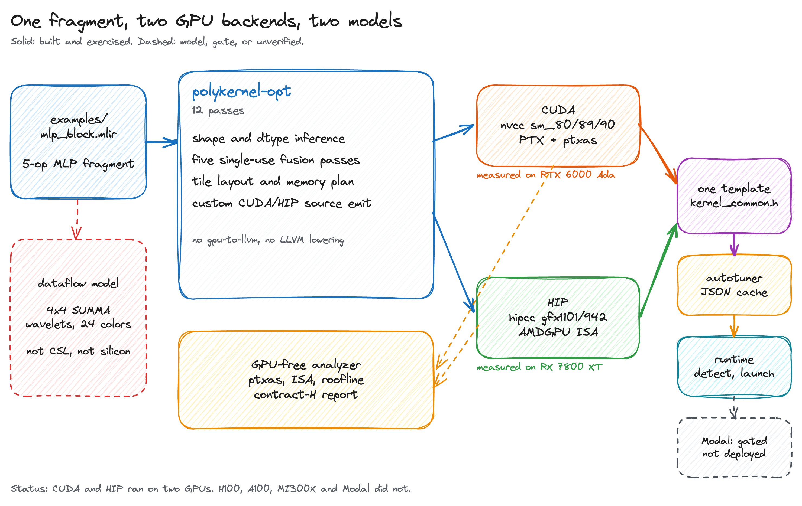
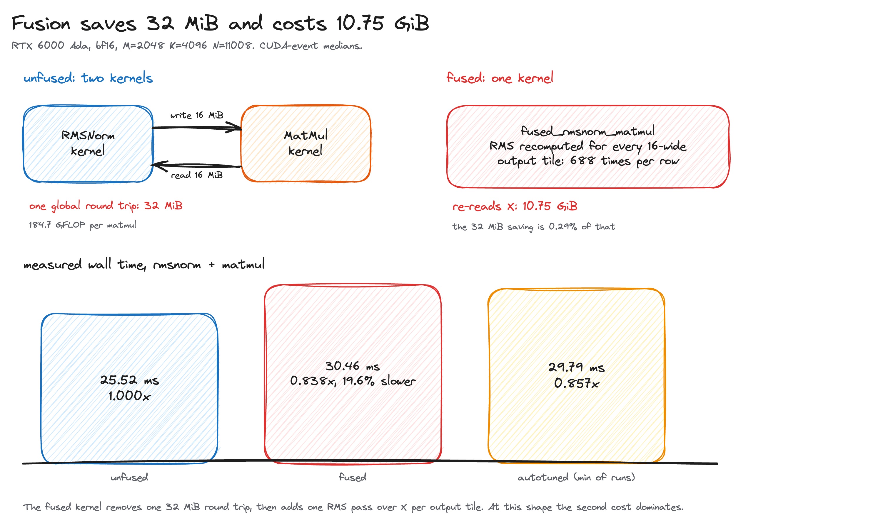

# PolyKernel

An out-of-tree MLIR compiler for a fused transformer MLP block, with CUDA and HIP backends, a correctness-gated autotuner, and a Cerebras-style dataflow model.

PolyKernel takes a hand-written MLIR fragment, runs twelve passes, and emits portable CUDA or HIP source for RMSNorm, matmul, GELU, softmax, attention, and their fused variants. The same emitted source compiles under `nvcc` and `hipcc`. A NumPy `ml_dtypes.bfloat16` golden checks the kernels, and a C++ analyzer reads `ptxas` or AMDGPU ISA output to report registers, shared memory, occupancy, and the roofline class without a device.

The project is for compiler and GPU engineers who want a small, readable example of an out-of-tree MLIR dialect, a two-vendor codegen path, and a test harness that can fail. It is not an inference engine, and it does not claim production performance.

Measured on an RTX 6000 Ada (sm_89) and an RX 7800 XT (gfx1101). The H100, A100, and MI300X numbers are projections. The Modal service is defined and was never deployed.

## Quick start

Linux x86_64 with Nix and flakes:

```bash
nix develop --impure --accept-flake-config

# Resolve the locked MLIR and LLVM from this checkout.
MLIR_DIR="$(nix eval --raw --impure --expr \
  '(builtins.getFlake (toString ./.)).inputs.nixpkgs.legacyPackages.x86_64-linux.llvmPackages_21.mlir.dev.outPath')/lib/cmake/mlir"
LLVM_DIR="$(nix eval --raw --impure --expr \
  '(builtins.getFlake (toString ./.)).inputs.nixpkgs.legacyPackages.x86_64-linux.llvmPackages_21.llvm.dev.outPath')/lib/cmake/llvm"

cmake -B build -G Ninja \
  -DMLIR_DIR="$MLIR_DIR" \
  -DLLVM_DIR="$LLVM_DIR" \
  -DMLIR_TABLEGEN_EXE="$(which mlir-tblgen)" \
  -DLLVM_EXTERNAL_LIT="$(dirname "$(readlink -f "$(which lit)")")/.lit-wrapped"
cmake --build build
cmake --build build --target check-polykernel
```

The last command runs the 14 lit tests. Run the pipeline on the MLP fragment:

```bash
./build/tools/polykernel-opt/polykernel-opt examples/mlp_block.mlir \
  --infer-shapes --canonicalize \
  --fuse-rmsnorm-matmul --fuse-matmul-bias-gelu \
  --infer-tile-layout --plan-memory --lower-to-cuda
```

The generated sources land in `kernels/generated/`. The CUDA and HIP passes emit the same compute; the driver picks the backend with `-DPOLYKERNEL_CUDA` or `-DPOLYKERNEL_HIP`.

## Architecture



The compiler is the left half: twelve passes for shape inference, canonicalization, five single-use fusion passes, tile layout, memory planning, CUDA or HIP source emission, and the kernel report. The two backends compile the same emitted source with different defines. The GPU-free analyzer reads the compiler output and produces the contract-H report. The dataflow model is a separate backend for the same fragment. The runtime chain is one portable template header, an autotuner with a JSON cache, a C++ launcher, and a Modal app that is gated and undeployed.

## The measured result



On the RTX 6000 Ada, the unfused RMSNorm plus matmul takes 25.52 ms. The fused kernel takes 30.46 ms, which is 0.838x. The fused kernel recomputes the row RMS for every 16-column output tile, so it re-reads 10.75 GiB of input to save a 32 MiB round trip. The autotuned figure of 29.79 ms is the minimum of repeated runs of the same kernel, not a different configuration.

The H100, A100, and MI300X rows in the report are roofline projections with stated attainment factors. They are not measurements. The report audits those projections and explains why the H100 and A100 rates exceed the scalar FP32 peaks of the hardware they name.

## Correctness

The golden is NumPy plus `ml_dtypes.bfloat16`: bf16 inputs with round-to-nearest-even, fp32 accumulation, bf16 output, cosine at least 0.999, maximum relative error at most 1e-2, and PCC at least 0.99.

The CUDA harness passed 17 of 17 golden cases on the RTX 6000 Ada, plus one negative launch test. The HIP harness passed 18 of 18 on the RX 7800 XT. The MMA kernel passed 5 of 5 on the Ada. The first NVIDIA run found two bugs, a bf16x2 store that corrupted one half of the pair and an erf-based GELU that saturated at the tail; both are fixed in commit `d85866a`.

These tests use small shapes. The 2048x11008x4096 benchmark shape is timed, not checked against the golden in the CUDA harness.

## Tests

```bash
cmake --build build --target check-polykernel        # 14 lit tests
ctest --test-dir build --output-on-failure           # 158 unit tests
python3 -m pytest tests/kernels/test_hip_run.py -q   # 18, needs gfx1101
python3 -m pytest tests/kernels/test_cuda_run.py -q  # 18, needs sm_89
```

The CUDA and HIP tests skip with a named reason when no device is present.

## Report

The full technical report is [report/polykernel-technical-report.pdf](report/polykernel-technical-report.pdf). It covers the compiler, both backends, the correctness evidence, the measured result, the projection audit, the dataflow model, the serving contract, and the test gaps. It replaces the earlier `docs/` and `reports/` directories.

The machine-readable benchmark inputs are in `report/data/`. The figures are Excalidraw scenes in `report/figures/`, rendered with the Excalidraw CLI.

## License

No license file is present yet.
